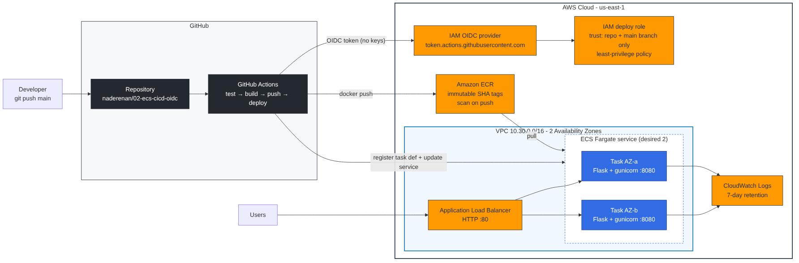

# ECS Fargate Microservice with GitHub Actions OIDC CI/CD


A containerised Python microservice on **Amazon ECS Fargate** behind an **Application Load Balancer**, deployed by **GitHub Actions** that authenticates to AWS with **OpenID Connect**. There are no AWS access keys in GitHub, ever. Every push to `main` runs tests, builds an image tagged with the git SHA, pushes it to ECR, and rolls it out with automatic rollback.



<!-- VERIFIED-RUN -->

## What this demonstrates

| Capability | Implementation |
|---|---|
| Infrastructure as Code | Terraform (`network.tf`, `ecr.tf`, `ecs.tf`, `alb.tf`, `oidc.tf`) |
| Keyless CI/CD | IAM OIDC provider for `token.actions.githubusercontent.com`. The deploy role trusts **only** `repo:<owner>/02-ecs-cicd-oidc:ref:refs/heads/main` |
| Least privilege | Deploy role can push to **this** ECR repo, update **this** service, and pass **only** the two task roles to `ecs-tasks.amazonaws.com` |
| Safe rollouts | ECS deployment circuit breaker with automatic rollback, ALB health checks, 50/200 % rolling deploys |
| Supply chain | Immutable image tags (git SHA), ECR scan on push, lifecycle policy keeps the last 10 images |
| High availability | 2 Fargate tasks spread across 2 Availability Zones behind the ALB |
| Container hardening | Slim base image, non-root user (UID 10001), no AWS permissions in the task role |
| Observability | Container logs in CloudWatch Logs (7-day retention) |

## Repository layout

```
.
├── app/                    # Flask service: /, /health, /products + pytest tests
├── Dockerfile              # slim, non-root, gunicorn
├── .github/workflows/
│   └── deploy.yml          # test -> build -> push (SHA tag) -> render task def -> deploy -> smoke test
├── terraform/
│   ├── network.tf          # 2-AZ VPC, IGW, security groups (tasks reachable only from the ALB)
│   ├── ecr.tf              # immutable, scanned, lifecycle-managed repository
│   ├── ecs.tf              # cluster, IAM roles, bootstrap task definition, service + circuit breaker
│   ├── alb.tf              # ALB, target group (ip), listener
│   ├── oidc.tf             # GitHub OIDC provider + least-privilege deploy role
│   └── outputs.tf          # app_url, github_deploy_role_arn, ...
├── scripts/autopilot.ps1   # deploy -> push -> wait for pipeline -> capture evidence -> destroy
├── screenshots/
└── CLIENT_REPORT.md
```

## How the bootstrap works

Terraform creates the service with a throwaway bootstrap container (`python -m http.server`) so the ALB has a healthy target from minute one. From then on **the pipeline owns the running revision**: `ecs.tf` ignores `task_definition` drift, and each push registers a new revision built from `./app`.

## Deploy

```bash
cd terraform
cp terraform.tfvars.example terraform.tfvars      # set github_repo
terraform init && terraform apply
terraform output github_deploy_role_arn
```

In the GitHub repo, open **Settings → Secrets and variables → Actions → Variables** and add:

| Variable | Value |
|---|---|
| `AWS_ROLE_ARN` | output `github_deploy_role_arn` |
| `APP_URL` | output `app_url` (used by the smoke test) |

Push to `main`. The workflow deploys the app, and `curl $(terraform output -raw app_url)` returns the new `version` (short SHA).

## Cost (us-east-1)

| Resource | ~USD/hr |
|---|---|
| Application Load Balancer | 0.0225 + LCU |
| 2 × Fargate task (0.25 vCPU, 0.5 GB) | ~0.025 |
| Public IPv4 (ALB + tasks) | ~0.02 |
| ECR, CloudWatch Logs | < 0.001 |
| **Total** | **~0.07** |

No NAT Gateway: tasks sit in public subnets with a security group that only admits the ALB. For production, move tasks to private subnets with NAT or VPC endpoints.

## Tear down

```bash
cd terraform && terraform destroy
```

ECR is created with `force_delete`, so its images go too. `scripts/autopilot.ps1` retries destroy until an audit finds no service, ALB, VPC or repository left.

## Production hardening (next steps)

- HTTPS listener with ACM + Route 53, HTTP→HTTPS redirect, AWS WAF on the ALB
- Private subnets + VPC endpoints (ECR, Logs, S3) instead of public task IPs
- Blue/green deployments with CodeDeploy, or canary with ECS deployment lifecycle hooks
- Image signing (Sigstore/Notation) and policy enforcement before deploy
- Remote Terraform state in S3 with locking. Separate staging/prod environments with required reviewers
